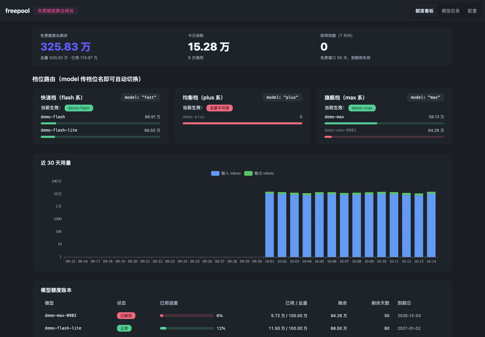
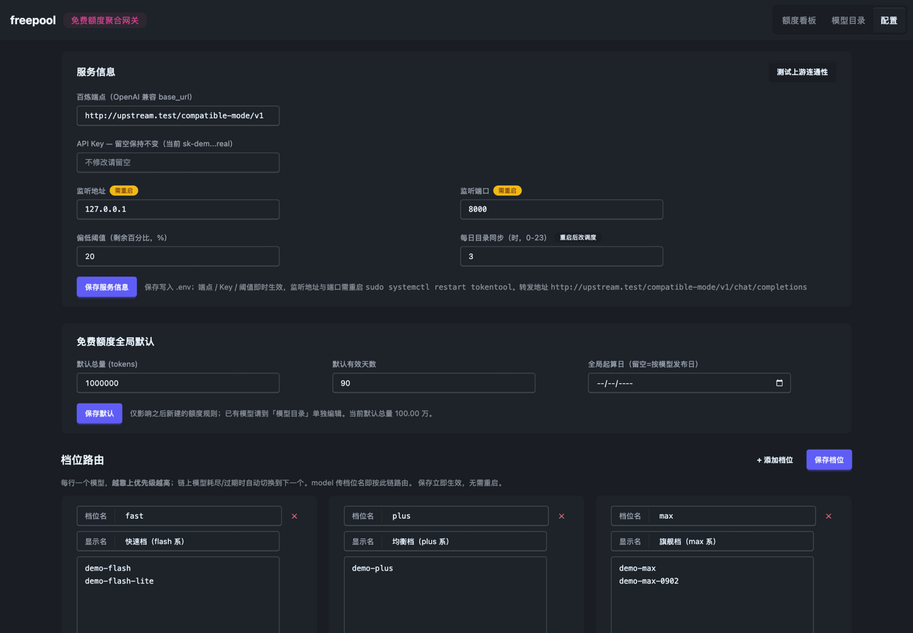

# freepool

**Aggregate & route your LLM free-token quotas behind one OpenAI-compatible gateway.**

一个本地 OpenAI 兼容网关：把大模型平台的**免费 Token 额度**聚合到一个账本里统一计量，
额度耗尽时按**档位**自动切换模型，并配有用量看板。当前支持**阿里云百炼**（DashScope），
多平台适配器见 [Roadmap](#roadmap)。



## 为什么需要它

大模型平台的免费额度（如百炼每模型 100 万 tokens、90 天有效）散落在控制台里，
官方没有可用 API Key 查询剩余量的接口，耗尽前很难感知；而且单一模型用完就只能切平台或付费。
freepool 的思路：

- **本地代理计量** —— 网关转发请求并累计每次响应的 `usage`，`剩余 = 免费总量 − 计量 − 手动初值`；
- **档位路由** —— 调用方 `model` 传 `fast` / `plus` / `max` 这类别名，网关按配置的模型链自动选择；
  链上模型耗尽（403 `AllocationQuota.FreeTierOnly`）或过期时**自动切换下一个**，调用方无感知；
- **多厂商混排** —— 同档位可以混排 qwen / deepseek / glm / kimi 等模型，各家免费池相互独立，
  相当于把可用额度扩大数倍。

## 功能

- **OpenAI 兼容代理**：`POST /v1/chat/completions`（流式 + 非流式）、`GET /v1/models`
  - 流式自动注入 `stream_options.include_usage` 捕获 usage 后剥离该 chunk，客户端零感知
- **档位路由与自动切换**：请求前按账本预检跳过已耗尽/过期模型；上游 403 FreeTierOnly
  标记耗尽并切换（仅在未向客户端写出字节时重试）；响应头 `x-tt-actual-model` 标注实际模型
- **额度账本**：每模型 总量 / 起算日 / 有效天数（默认 100 万 / 90 天）/ 接入前 offset；
  状态机：正常 / 偏低(<20%) / 已耗尽 / 已过期 / 已下线
- **官方目录同步**：`GET /api/v1/models` + `/api/v1/models/limits`（sk- key 可用），
  每日定时 + 手动触发，354+ 模型的能力/上下文/价格/发布时间入库
- **看板**：汇总卡片、档位健康度、30 天用量图（ECharts）、模型额度表、调用明细（含切换原因）、30s 自动刷新
- **可视化配置页**：档位链编辑（保存即热生效）、全局默认、服务信息（.env 编辑 + 上游连通性测试）
- **批量校准脚本**：从控制台「免费额度」页数据一键校准全部起算日与 offset

## 架构

```
现有应用（任意 OpenAI 客户端）
      │  只改 base_url；model 可传档位别名或具体模型名
      ▼
freepool 网关 (FastAPI, :8000)
  ├─ POST /v1/chat/completions
  │     ├─ 档位路由：别名 → 有序模型链（tiers.yaml）
  │     ├─ 预检：额度账本跳过 已耗尽/已过期/已下线
  │     ├─ 转发百炼 compatible-mode/v1（流式/非流式），捕获 usage 落库
  │     └─ 403 FreeTierOnly → 标记耗尽 → 切换下一个候选
  ├─ SQLite 账本（usage_records / quota_rules / catalog）
  ├─ 官方目录同步（APScheduler 每日 + 手动）
  ├─ /api/* 看板与配置接口
  └─ 托管 Vue3 前端构建产物
```

## 快速开始

要求 Python 3.11+ 与 Node.js 18+。

```bash
git clone https://github.com/<your-username>/freepool.git
cd freepool
make install        # venv + pip 依赖 + 前端 npm install
cp .env.example .env   # 填入 BAILIAN_API_KEY 与 BAILIAN_BASE_URL
make build          # 构建前端到 frontend/dist
make dev-backend    # 启动 http://127.0.0.1:8000
```

打开 http://127.0.0.1:8000 即是看板。开发前端热更新用 `make dev-frontend`（Vite :5173）。

## 接入现有应用（改两行）

```bash
OPENAI_BASE_URL=http://127.0.0.1:8000/v1   # 或 http://<your-host>:8000/v1
OPENAI_MODEL=fast                          # 档位别名 fast/plus/max，也可用具体模型名
```

任意 OpenAI SDK / LangChain / OpenWebUI 等均适用；具体模型名也会在其所属档位内自动回退。

```bash
curl http://127.0.0.1:8000/v1/chat/completions \
  -H 'Content-Type: application/json' \
  -d '{"model":"fast","messages":[{"role":"user","content":"你好"}]}'
# 响应头 x-tt-actual-model: qwen3.7-flash
```

## 配置

| 文件 / 位置 | 内容 |
|---|---|
| `.env` | `BAILIAN_API_KEY`、`BAILIAN_BASE_URL`（业务空间或官方 dashscope 端点）、监听地址/端口 |
| `config/tiers.yaml` | 档位定义：别名 → 有序模型链（看板「配置」页可视化编辑，保存热生效） |
| `config/free_models.yaml` | 免费额度默认值与按模型覆盖（总量/起算日/有效天数/offset） |

### 校准免费额度（重要）

免费额度窗口 = max(账号开通日, 模型发布日) + 90 天。默认起算日取「模型发布时间，
否则首次经过网关的日期」；若你的百炼开通晚于模型发布，看板会**过早**判过期。校准方式：

1. 打开 [控制台免费额度页](https://bailian.console.aliyun.com/cn-beijing/costing-balance/free-quota)，
   记下各模型的实际到期时间与剩余量；
2. 看板「模型目录 → 编辑」逐个改，或把数据填入 `scripts/calibrate_from_console.py`
   的 `CONSOLE` 列表后执行 `PYTHONPATH=. .venv/bin/python scripts/calibrate_from_console.py`
   —— 它会批量写入起算日（=到期 − 90 天）、offset（控制台已用 − 网关计量），并把真实值写回 yaml；
3. 接入网关前已消耗的量填 `used_offset`。



## 部署到 Linux 服务器（systemd）

```bash
# 服务器上
git clone https://github.com/<your-username>/freepool.git ~/apps/freepool
cd ~/apps/freepool && python3 -m venv .venv && .venv/bin/pip install -r requirements.txt
cp .env.example .env && nano .env    # 填 key；APP_HOST=0.0.0.0 供局域网访问
make build                           # 需要 node；无 node 可在本机构建后 rsync frontend/dist/

sudo tee /etc/systemd/system/freepool.service >/dev/null <<'EOF'
[Unit]
Description=freepool - LLM free-quota gateway
After=network-online.target

[Service]
Type=simple
User=<your-user>
WorkingDirectory=/home/<your-user>/apps/freepool
ExecStart=/home/<your-user>/apps/freepool/.venv/bin/uvicorn app.main:app --host 0.0.0.0 --port 8000
Restart=always
RestartSec=3

[Install]
WantedBy=multi-user.target
EOF
sudo systemctl enable --now freepool
```

后续更新：`git pull && .venv/bin/pip install -r requirements.txt && make build &&
sudo systemctl restart freepool`。`.env`、`data/`、`config/` 不在 git 内，
更新不会覆盖你的密钥与账本。

## 已知边界

- 只计量**经过网关**的调用；直连平台的消耗用 `used_offset` 校准
- 流式调用客户端中途断开时，上游已产生的 token 计不到（usage chunk 未到达），会落库一条 0 记录
- 免费额度窗口因账号而异，务必按上节校准起算日
- 配置接口无鉴权，请在可信网络内暴露（局域网 / WireGuard / SSH 隧道）

## 排障笔记：WireGuard 大包黑洞

若网关部署在 WireGuard 网内，出现「小请求正常、大请求（长 prompt）卡满超时且网关零日志」，
基本是隧道 MTU 黑洞：wg 默认 MTU 1420，中间链路有效 PMTU 更小时满段大包被静默丢弃。
两端 wg 配置加 `MTU = 1380` 重启隧道即可。可用
`ping -M do -s 1380 <peer-ip>` 二分定位可用包长。

## Roadmap

- [ ] **多平台适配器**：抽象 `Provider` 协议，支持 DeepSeek / Moonshot / 智谱 GLM 等免费额度平台
- [ ] 多 API Key 池轮询（同平台多 key 叠加额度）
- [ ] 额度偏低/临期 webhook 告警
- [ ] Docker 镜像与 docker-compose
- [ ] `/v1/embeddings` 等更多透传端点
- [ ] 探索控制台接口获取精确官方余量（当前为本地计量口径）

## 贡献

见 [CONTRIBUTING.md](CONTRIBUTING.md)——跑测试的方式、提交约定，以及多平台适配器的
重构方向说明。欢迎 Issue 讨论。

## License

[MIT](LICENSE)
